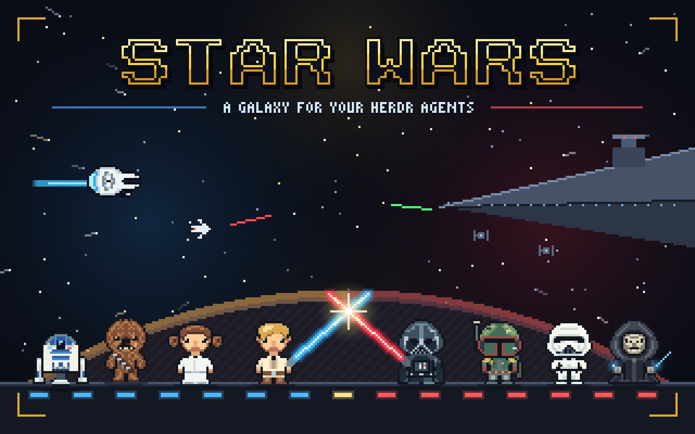

# Star Wars

A two-theme Herdr layout with a ship-and-Git sidebar, a character-based agent board, status bar, notifications, an optional animated battle overlay, and a Bomberman-style arcade overlay. Copy this folder into a Herdr app home to install the layout and every custom mod it uses.



## What you see

The layout is a full-height window split into a sidebar and work area. The preview is an illustration, not a screenshot: it shows the Light Side and Dark Side palettes side by side, built from the project's own artwork.

- **Left sidebar — 268 px by default; 44–480 px range.** The top `workspace-chrome` brand block is 46 px. Below it, Fleet and Agents share the remaining height equally, with a 90 px minimum each. The 69 px `workspace-chrome` footer sits at the bottom. The sidebar uses the `chrome` theme color.
- **Fleet — upper sidebar list.** Each space has a stable ship emblem and name. Git repository, branch and upstream counts appear when available. Remote spaces are grouped under machine headers.
- **Agents — lower sidebar list.** Agent cards show their Star Wars character, status, model and context use when detected. Mini battles appear for spaces with multiple agents.
- **Work area — remaining width.** The `star-wars-tabs` bar is 42 px high: Herdr's tab pills and + menu, then **Files**, **Changes** and **Bomb Run** panel buttons at the right (14 px icon + 12 px label, 26 px high, `selected` background when that panel is open). The work body has 8 px padding and an 8 px gap. The active tab fills the center. Its panes have transparent backgrounds, 1 px theme borders, an `input` focus border, 8 px corner radius, 8 px gaps and a 30 px `pane` header that is always visible.
- **Files/Changes/Bomb Run panel — initially hidden.** It is a 368 px column (280–900 px) stacking Files, Changes and Bomb Run with no strip of its own; the top-bar buttons choose which one shows. Files is selected initially.
- **Status bar — 28 px at the bottom of the work area.** Shows the active machine, branch and non-zero agent status counts.

The initial layout background is the Dark Side Millennium Falcon cockpit, cover-fitted. Fleet changes it to the active space's assigned ship and current appearance. Terminal opacity is 0.88 with `[14, 12]` px vertical/horizontal padding. The title bar is hidden; macOS traffic lights are placed at `[12, 16]`. The UI font is `.SystemUIFont`.

| Role | Light Side | Dark Side |
| --- | --- | --- |
| Background / foreground | `#f7f5ef` / `#28323a` | `#141619` / `#deded6` |
| Chrome | `#eeece5` | `#1b1e22` |
| Accent | `#22688d` | `#e07a78` |
| Working / blocked / done | `#805a1c` / `#a74240` / `#266e5a` | `#d5b77c` / `#e58b88` / `#85b99c` |

## How it behaves

### Agent board

Agents can be sorted by **Priority** (Needs you, Done, Working, Idle) or **Grouped by space**. Group and sub-agent rows fold. Clicking an agent focuses its pane; the pin control appears on hover and pins/unpins the agent. Agent cards can show the detected model and context percentage. The model/context read is optional and refreshes every 15 seconds. Below 160 px, the sidebar switches to its compact rail.

Statuses are shown as follows:

- **Working:** colored dot; the card says “On mission,” then “Hyperspace” after 10 minutes, “Deep space” after 30 minutes and “Trench run” after an hour.
- **Blocked:** red “Needs you” label and `!`; the character card says “Needs backup.”
- **Done:** completion dot and `✦`; the card says “Mission complete.”
- **Idle:** outlined status ring; the card says “On standby.”

There are 14 standard characters and Darth Vader on the Dark Side. Character assignments are unique across agents; Stormtroopers are assigned again after the other available characters are used. Vader is assigned to one agent on the Dark Side whenever agents are present. Mini battles include pair-based quotes: Vader/Luke (“I am your father.”), Luke/Yoda, Han/Chewbacca and Leia/R2-D2.

### Fleet

Click a space to select it, right-click for the space menu, and drag it to reorder within its machine group. The plus button creates a space. Click a machine header to fold/unfold that group. Hover a ship emblem for its name. Git status is read-only; the explicit **Connect** control is the only action that runs `hc machine rm/add`.

Use the command palette or run `star-wars-systems.light` / `star-wars-systems.dark` to select an appearance. The commands change both the appearance and palette while preserving unrelated settings. The layout follows system appearance until a side is selected explicitly.

### Status, alerts and arena

The status bar counts blocked, done, working and idle agents, and opens the command palette when clicked. The Herdr app badge counts agents that need attention.

Agent “finished” and “needs you” alerts use the assigned character's name, art and custom line. Clicking an alert runs its supplied action, if any, and closes it. System banners are sent when the Herdr window is inactive: `terminal-notifier` on macOS, `notify-send` on Linux, and in-app alerts only on Windows. Missing or failing helpers leave the in-app alert as the fallback. Do not use AppleScript notification fallbacks: clicking those banners can open Script Editor instead of Herdr. Install the macOS helper with `brew install terminal-notifier`; its banner clicks target `dev.herdr.app`.

Open **Star Wars: Battle Simulator** from the command palette or with `herdr-app do mod.open --name star-wars-arena`. Pause/Resume, Close and Escape control the overlay. `Ctrl-Shift-L` cycles layouts; there are no layout-specific key bindings. Choose Classic, Jedi, Hunters or Senate, or select 2–8 fighters from the full cast in Custom mode. Up to four fronts run simultaneously. Speech bubbles identify current and previous speakers. Speed, pause, replay and reduced-motion controls affect only the simulation; it does not create, move or message real agents. The 704×560 px overlay keeps its header and controls outside the scrollable content.

Open **Star Wars: Bomb Run** from the **Bomb Run** button in the top bar, beside Files and Changes, or with `herdr-app do mod.open --name star-wars-bomb-run`. Its compact chrome follows Herdr's theme around a pixel-art ship interior: forward windows, wall consoles, coolant cells and thermal detonators. A 36 px icon toolbar replaces the previous stacked control bars; a 26 px inline HUD and 40 px pilot strip stay attached to the board. The sliders icon opens scrollable mission options and upgrades. Directional buttons are optional, while core actions remain keyboard-operable. End-state cards sit low in the scene instead of obscuring its center. Start with Enter or **Start mission**, hold WASD/arrows to walk, and press Space to plant a charge. P/Escape pauses, Enter resumes, R returns to the start screen. The far-right toolbar × always closes/hides the game, separately from Expand; Escape from the start/defeat/pause screen also closes it. It automatically pauses when focus leaves, another panel tab is selected, or Herdr is hidden. Four-direction three-pose character atlases replace the previous bounce animation. Named characters are unique across pilot and enemies; only Stormtroopers can repeat. Eight zones have different wall maps, architecture and props: Reactor, Hangar, Cryo, Cargo, Engines, Bridge, Detention and Foundry. Later sectors cycle zones with new coolant/roster variants, faster patrols and up to eight hostiles. There are no collectible or stackable buffs. Upgrades require both deck progression and XP: Range at deck 2/200 XP, Rack at deck 3/600, Line at deck 5/900, Nova at deck 6/1400, Speed at deck 7/1800 and Echo at deck 8/2400. Range is capped at five tiles, capacity at three charges and speed at 120 ms/tile. E selects Standard, Nova or Echo; the two special payloads cannot stack. Retrying preserves milestone unlocks and starts with Standard. Cells award 5 XP, enemies 40 XP and deck clears 75 XP. Cadet/Scout/Veteran/Commander/Legend ranks mark 0/200/600/1200/2200 XP; combat upgrades additionally require their deck milestone. Local per-agent profiles retain XP and the highest unlocked deck across retries and reopening. Pilot selection loads that agent's progress. The toolbar link icon and the descriptive **Thinking only** switch in Mission options share a persisted setting that defaults to Off; when On, only the selected agent's `working` status permits play. All other statuses or disconnection freeze simulation and inputs without resetting the mission. Returning to working resumes a running mission unless it was manually/focus-paused. The game never commands real agents.

## Built from

### Layout tree

`layouts/star-wars.json` defines one root `row`:

```text
root row
├── sidebar column (268 px; min 44, max 480; chrome)
│   ├── brand block: workspace-chrome (46 px, window drag)
│   ├── sidebar-lists column
│   │   ├── spaces block: star-wars-systems (weight 1, min 90 px)
│   │   └── agents block: star-wars-agents (weight 1, min 90 px)
│   └── sidebar-footer block: workspace-chrome { footer: true } (69 px)
└── work column
    ├── tabs block: star-wars-tabs (42 px, window drag)
    ├── work-body row (8 px padding, 8 px gap)
    │   ├── main block: active tab, pane header from pane mod
    │   └── panel column (368 px, min 280, max 900, hidden)
    │       └── panel-body stack (no header): Files active, Changes, Bomb Run
    └── status block: star-wars-status (28 px)
```

Root settings: 1 px `border` divider; Dark Side Millennium Falcon background with `cover`; terminal opacity 0.88; terminal padding `[14, 12]`; no title bar; traffic lights `[12, 16]`; `star-wars-alerts` toast; `light-side`/`dark-side` theme mapping; `.SystemUIFont`; `preview.png` preview. The main pane is transparent, has a 1 px `border`, an `input` focus border, 8 px radius/gap, and a 30 px always-visible `pane` header.

### Mods, host APIs and programs

- **`star-wars-systems`** — Fleet and appearance commands. Reads `spaces()`, `machines()`, `panes()`, `layout()`, `settings()` and shared state. Calls `hc machine ls`; runs read-only Git `rev-parse`, `symbolic-ref` and `rev-list` through `exec`; watches local repositories with `watchFolder`. Uses `run` for `space.new`, `space.select`, `space.move`, `layout.set`, `app.theme` and `app.settings`. Its Connect button explicitly invokes `hc machine rm/add`. Ships and colors are stored in `star-wars.ships` and `space.colors`.
- **`star-wars-agents`** — Agent list, cards, stable character assignments and mini battles. Reads `agents()`, `terminals()`, `panes()`, `focused()`, `spaces()`, `settings()` and `layout()`; reads terminal output through `hc read`; updates navigation order with `setAgentOrder`. Uses `run` for `pane.focus` and `terminal.pin`. Character state is stored in `star-wars-agents.cast`; if that key is absent, existing assignments are copied from `fellowship.cast` without clearing the old key, so another layout can keep using it. Its local helpers parse terminal stats, balance the cast and render sprites/battles.
- **`star-wars-status`** — Footer status and app badge. Reads `spaces()`, `agents()`, `keys()` and `window()`; calls `setBadge` and `run("app.palette")`.
- **`star-wars-alerts`** — Toast rendering and optional OS banners. Reads `props()`, theme, window and shared character assignments; calls `run` for the alert action and `closeOverlay`. Uses `exec` for `terminal-notifier` and `notify-send` when available. It never uses an AppleScript fallback.
- **`star-wars-arena`** — Configurable training overlay. `choreography.js` holds character profiles, presets and dialogue; `scene.js` renders native animation; `main.js` owns the selection and playback controls. Reads `spaces()`, `shared()`, `settings()`, `checking()` and `window()`; calls `closeOverlay`. A slow narrative timer advances dialogue, but movement uses native loops. It does not call agent or terminal commands.
- **`star-wars-tabs`** — A copy of Herdr's built-in `tabs` mod (0.1.16) with one extra panel button. Same tab pills, + menu, drag-to-reorder, wheel switching and window buttons. Its right side shows Files and Changes (as enabled by shared `workspace.panels`) plus an always-present **Bomb Run** button with `bomb.svg`. A click calls `layout.select {stack: "panel-body", child}` then `layout.show {id: "panel"}`; clicking the open one calls `layout.hide`. The open panel is remembered per space in its `localStorage` key `panels`, Bomb Run included. The palette entry **Star Wars: Toggle Bomb Run** (`star-wars-tabs.toggle-bomb-run`) flips shared `star-wars.bomb-run` (absent = on); when off, the button is gone, Bomb Run is never restored per space, and an open Bomb Run panel is hidden.
- **`star-wars-bomb-run`** — Pixel-art game panel. `decks.js` defines eight zone identities and fixed wall maps; `game.js` owns collision, unique rosters, XP/ranks, deck-gated upgrades, exclusive Nova/Echo payloads and blast geometry, charge/line planting, hostiles and scores; `scene.js` renders the deck, directional walking atlases and compact state ribbons; `ui.js` owns the toolbar, inline HUD, pilot strip, optional directional controls and options drawer; `main.js` owns live pilots, input and game state. Opening options pauses an active mission; closing options does not silently resume it. Escape dismisses options before closing the game. `tools/build-bomb-run-art.py` builds all local artwork from pixel geometry and the existing cast. A 40 ms simulation tick supports the exact 120 ms speed milestone and advances discrete states; GPUI interpolates positions natively. Runs wait for Start and auto-pause when not focused/visible. Only UI commands open a larger overlay or hide the game panel. `localStorage` key `pilot-progress` holds per-agent `{xp, level}` records; `thinking-only` stores the optional working-status gate. Neither is read or written during Herdr checks.

The layout also requires Herdr's built-in `workspace-chrome`, `pane`, `files` and `changes` mods (`star-wars-tabs` also reuses the built-in `tabs` window-button and `pane` close SVGs). Its local runtime assets are the two theme JSON files, seven ship emblem SVGs, light/dark cockpit images, 15 character SVGs, weapon SVGs and the arena saber SVGs. No runtime network access is used.

## Watch out

- Copy the entire package home, not just the layout JSON. Its theme names, cockpit backgrounds, sprite paths and seven custom mod IDs must resolve from the Herdr app home.
- The recipe describes the Herdr mod API lineage recorded in `mod.json` (0.1.16). Run `herdr-app check` with the target Herdr version; host APIs can change.
- Model and context details only appear when an agent's terminal output matches a supported status-line format. Missing details do not indicate an error.
- Git reads do not modify repositories. Connecting to a rebuilt machine does change machine registration, but only after the user clicks Connect.
- The Battle Simulator requires `choreography.js` and the complete shared weapon assets, including purple/white sabers and Force lightning. Keep its three JavaScript modules, `mod.json` and dependent SVGs in sync when updating an installation.
- The built-in `tabs` mod hard-codes Files and Changes; that is why the layout ships `star-wars-tabs`. A fresh build that keeps `tabs` loses the Bomb Run button. Don't add a `header` to `panel-body` either, or Bomb Run gets a second, duplicate tab strip.
- The star sprites are fan art. Preserve the MIT license and the source lineage in each mod's `mod.json`.

## Done when

1. `herdr-app check` passes for all seven `mods/star-wars-*` folders.
2. `herdr-app do layout.switch --name star-wars` loads without layout/mod errors and shows Fleet, Agents, tabs, pane, status and the cockpit background; the top bar's Files, Changes and Bomb Run buttons each open that panel and close it on a second click; **Star Wars: Toggle Bomb Run** removes and restores the Bomb Run button.
3. Light Side and Dark Side commands change both theme and cockpit while preserving unrelated settings; system appearance is followed before an explicit side is selected.
4. Selecting and reordering spaces, folding machine/agent groups, focusing and pinning agents work. Two agents in a space produce a mini battle; matching character pairs show the related quote.
5. The Battle Simulator opens from the palette with Classic/Jedi/Hunters/Senate/Custom controls, supports 2–8 fighters, shows speaker bubbles, pauses/resumes, closes with its button or Escape, and leaves real agents unchanged.
6. Bomb Run fits the side panel at Herdr's zoom, offers eight distinct zones and six XP/deck milestones, has no loot/stacking, freezes all simulation and inputs when Thinking only is On and the selected agent is not working, respects walls/capacities/echo delays, keeps characters unique, preserves per-agent XP and unlocked decks, auto-pauses on focus/tab changes, and leaves real agents untouched.
